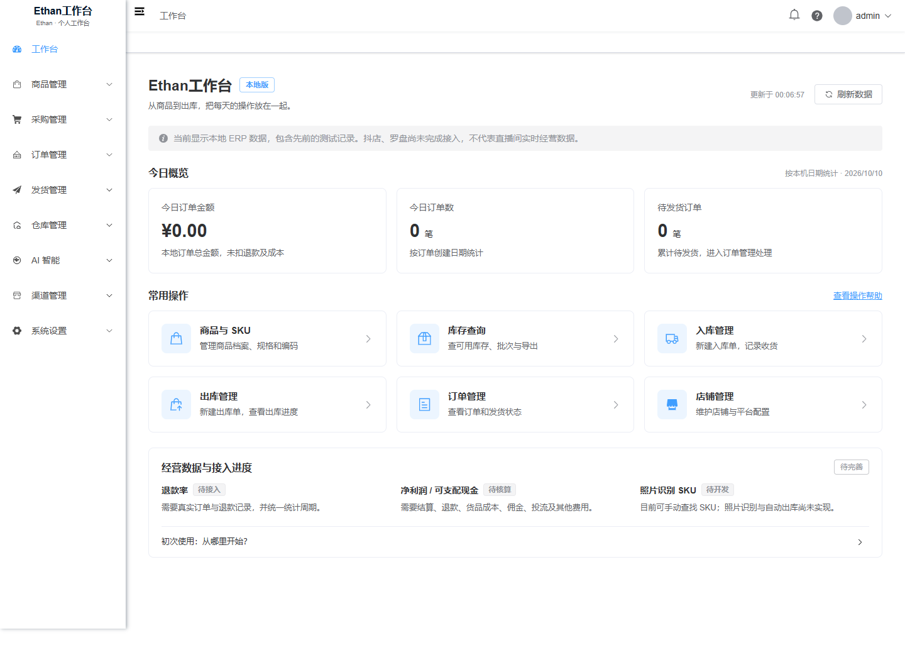

# Ethan工作台

Ethan 的个人直播电商工作台，基于 [启航 ERP](https://github.com/zeasin/qihang-erp-open) 开源项目进行本地部署和使用体验定制。

把商品、SKU、库存、出入库、订单与店铺的常用操作集中在一个工作台中。当前为本地试用版本，页面中的演示数据不代表真实经营结果。

## 已完成

- **个人品牌**：Ethan工作台名称、E 图标、登录页及个人署名。
- **常用入口**：商品与 SKU、库存查询、入库、出库、订单、店铺六个快捷入口。
- **库存操作**：SKU 筛选、批次查看、清晰的编码展示、当前页 CSV 导出。
- **本地概览**：今日订单金额、订单数量、待发货数量；接口异常时显示不可用状态。
- **使用体验**：中文分页与错误提示、记住登录账号、密码显示开关、Windows 本机账号查看窗口。
- **本地运行**：回环地址访问、定时任务开关、启动和停止辅助脚本。

## 当前边界

照片识别 SKU、图片自动出库、抖店真实授权和罗盘数据接入尚未完成。退款率、现金流与净利润核算仍需开发并接入真实数据。项目现有 AI 助手不等同于图片识别能力。

当前金额来自本地订单，不是平台结算收入或可支配现金。尚未验证全部上游业务、并发扣库存、重复提交及退款回库流程。

## 技术与运行

- Java 17、Spring Boot 4.1、MyBatis-Plus
- Vue 3、TypeScript、Element Plus、Vite
- MySQL 8.x、Redis

查看 [源码部署说明](docs/SETUP.md)。仓库不包含数据库数据目录、真实账号密码、平台密钥、依赖安装包或构建产物。首次克隆需要自行安装依赖、初始化一个空数据库并生成本地配置；现有的 Windows 启动脚本不能代替首次环境安装。

| 目录 | 内容 |
|---|---|
| `qihang-erp-local/` | Java 后端与 Vue 前端源码 |
| `local-deployment/` | 原本机启动、停止、构建与账号查看辅助脚本 |
| `tools/` | 生成私有本地配置与管理员初始化 SQL |
| `docs/` | 部署说明与已检查的界面截图 |

## 验证记录

本机已完成前端类型检查及构建、后端构建、登录、六个工作台入口、库存筛选、批次查看、CSV 下载及概览失败后恢复验证。历史界面验证截图拍摄于 2026-10-10。这不代表全部上游功能经过完整业务测试。

## 开源来源

基于 `zeasin/qihang-erp-open` 4.1.0，导入提交 `f454a62df63ce1739e080fa730587adab1ebfb49`。此仓库是 Ethan 的定制版本，保留上游作者署名和 [AGPL-3.0 许可证](LICENSE)，不声称原 ERP 为个人从零编写。

定制和发布整理说明见 [NOTICE.md](NOTICE.md)。
